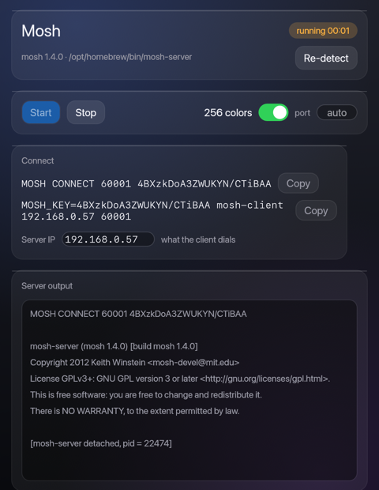

# Simple Mosh GUI

A tiny Rust/egui app that finds `mosh-server` on your machine, starts it, and
hands you the connection details — the `MOSH CONNECT <port> <key>` line and a
ready-to-copy `mosh-client` command.

Built for macOS and Linux — wherever `mosh-server` runs. Your phone (Android
included) is just a client: connect to the session with any mosh client, using
the command this app hands you or plain `mosh user@host`.



## Why

`mosh` normally starts `mosh-server` for you over SSH. When you want a mosh
session on a machine you can't SSH into first — or you just want the port and
key handed to you — you run `mosh-server new` by hand and copy them out of the
terminal. This is a small panel around that
([background](https://v4.chriskrycho.com/2017/set-up-mosh-on-macos.html)).

## Install mosh

- macOS: `brew install mosh` (or MacPorts: `sudo port install mosh`)
- Debian/Ubuntu: `sudo apt install mosh` · Fedora: `sudo dnf install mosh` ·
  Arch: `sudo pacman -S mosh`

## Run

```sh
cargo run --release
# optional: put it on your PATH
cargo install --path .
```

`simple-mosh-gui --detect` prints which `mosh-server` was found and exits
non-zero if none — handy for scripts.

## What it does

- Detects `mosh-server` in `$PATH`, plus `/opt/homebrew/bin`, `/opt/local/bin`
  (macOS) and `/usr/local/bin`, `/usr/bin` (Linux and manual installs).
- Starts `mosh-server new` with 256 colors (toggleable) and an optional port.
- Shows the connect line and `MOSH_KEY=<key> mosh-client <ip> <port>`, each one
  click to copy. The IP is pre-filled from the default route and is editable.
- Streams the server's raw output and can stop the session.

Notes:

- `mosh-server` prints its handshake and detaches; the app tracks the detached
  pid, so Stop kills the right process.
- A server that no client contacts exits by itself after 60 seconds; the app
  reports that as “session ended”.
- Closing the window does not kill running sessions (mosh semantics).
- If the environment has no UTF-8 locale (typical for apps launched from the
  Dock), the app passes mosh-server's `-l LANG=en_US.UTF-8` fallback — the same
  trick the mosh client uses when it starts a server over ssh.

## Linux

Same app, same flow: detection covers `$PATH`, `/usr/local/bin` and `/usr/bin`.
egui's X11 and Wayland backends are both enabled.

Building from source needs the usual desktop development libraries; if the
build complains about missing X11/Wayland headers on Debian/Ubuntu:

```sh
sudo apt-get install libxcb-render0-dev libxcb-shape0-dev libxcb-xfixes0-dev libxkbcommon-dev
```

## Development

```sh
cargo test                       # parser/unit tests
cargo run --example live_smoke   # starts and stops a real mosh-server end-to-end
```

## License

MIT — see [LICENSE](LICENSE).
